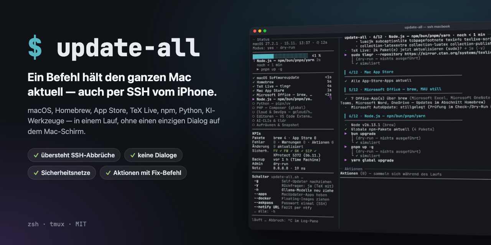
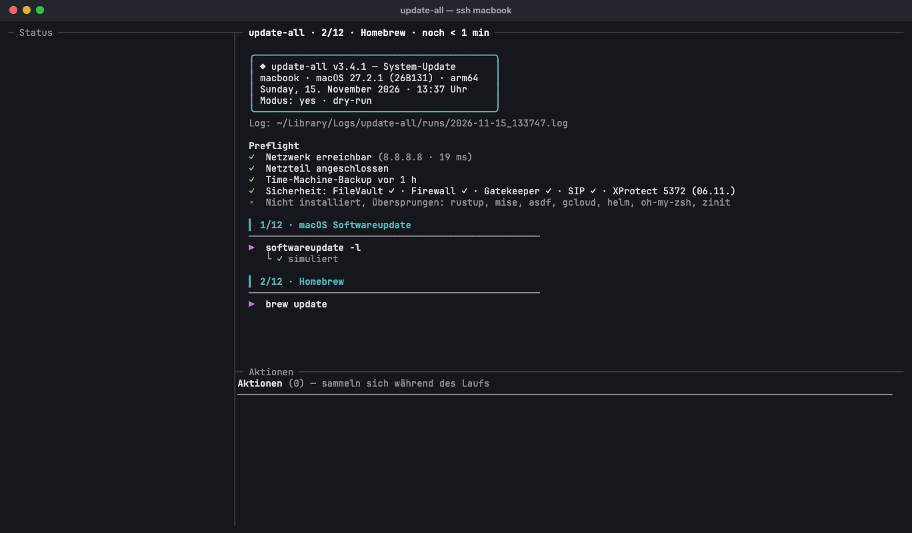
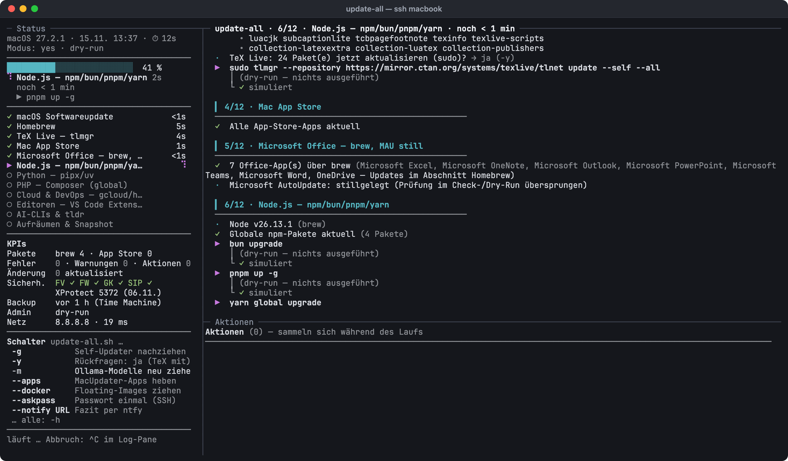
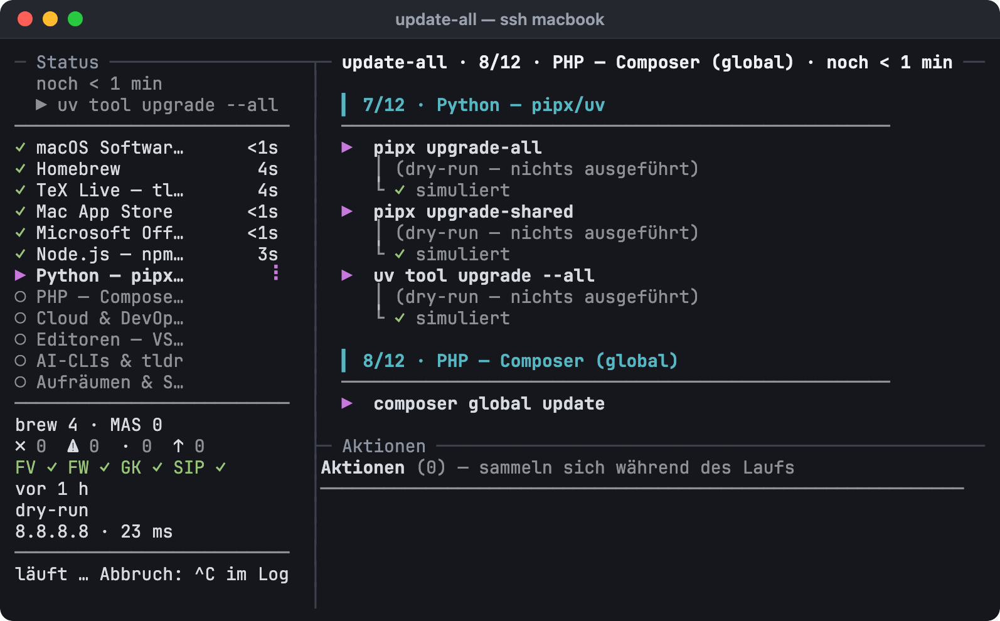
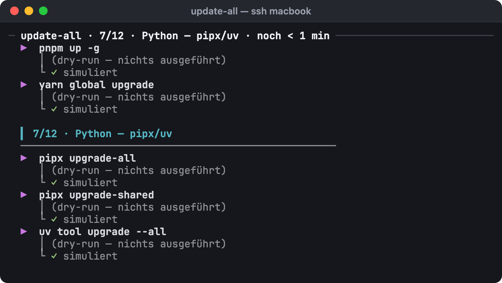
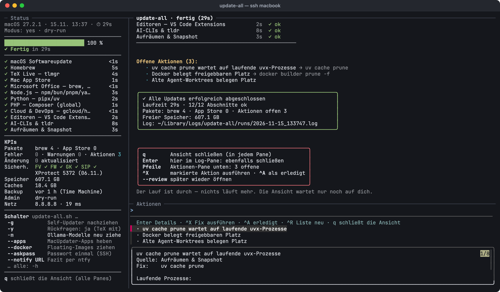

<p align="center">
  
</p>

# update-all

**Ein Befehl hält den ganzen Mac aktuell — auch per SSH vom iPhone, ohne einen einzigen Dialog auf dem Mac-Schirm.**
macOS, Homebrew, App Store, TeX Live, npm, Python, VS Code, KI-Werkzeuge und mehr in einem Lauf — mit einer tmux-Ansicht, die einen Verbindungsabbruch übersteht, Sicherheitsnetzen gegen ungewollte Sprünge und einer Aufgabenliste für alles, was du danach entscheiden musst. Ein einziges zsh-Skript. Kein Dienst, kein Daemon, keine Installation.

[](https://github.com/Bingerminger/update-all/actions/workflows/ci.yml)
[](LICENSE)


[](https://buymeacoffee.com/bingerminger)


<sub>Aufnahme eines `--dry-run` — nichts wird installiert.</sub>

## Warum update-all?

Gebaut für einen Mac, der meistens **aus der Ferne** gepflegt wird: per SSH vom Laptop, vom iPad oder vom iPhone — während der Bildschirm daheim aus ist und niemand davorsitzt, um ein Fenster wegzuklicken.

- **Gemacht für Entwickler-Macs.** Neben macOS, Homebrew und App Store hält ein Lauf auch den Werkzeugkasten aktuell: globale npm-, bun- und pnpm-Pakete, pipx und uv tools, Rust, Composer, mise/asdf, gcloud, helm, gh-Extensions, VS-Code-Extensions, Claude Code samt Plugins, codex, TeX Live — und auf Wunsch Docker-Images und Ollama-Modelle.
- **Läuft weiter, wenn die Verbindung abreißt.** Der Lauf steckt in tmux. Funkloch, Zug im Tunnel, iPhone gesperrt: Beim nächsten `update-all` hängst du dich einfach wieder an. Ohne Hintergrunddienst, ohne LaunchAgent — und der Mac bleibt wach, solange der Lauf dauert.
- **Kein Dialog auf dem Mac-Schirm.** Keine Gatekeeper-Rückfrage nach einem Cask-Update, keine Automation-Abfrage beim Beenden laufender Apps, kein fünffaches Admin-Passwort. update-all fragt es einmal ab und reicht es an jeden Schritt weiter — auch nach Homebrews Ticket-Reset.
- **Sicherheitsnetze statt Überraschungen.** Apps mit eigenem Updater (VS Code, Docker Desktop, iTerm2, Cursor …) hebt update-all nur, wenn sie wirklich hinterherhinken. Bezahl-Upgrades wie bei BBEdit oder Geekbench sperrt eine Liste. Laufende Apps beendet es sauber und startet sie danach wieder — Docker Desktop darf vorher seine VM herunterfahren. Was beim Update kaputtgeht (Parallels), fasst brew nie an. macOS-Updates mit Neustart meldet es nur — den Zeitpunkt wählst du.
- **Eine Aufgabenliste statt Log-Wüste.** Alles, was nach dem Lauf zu entscheiden ist, wird zur Aktion mit Erklärung und fertigem Befehl: `Enter` zeigt Details, `^X` führt den Fix aus, `^A` hakt ab. Ein unveränderter Hinweis aus dem letzten Lauf zählt nicht noch einmal als offen.
- **Ehrlich.** Ein hängendes Tool gilt nie als „nichts zu tun“. Was der App Store als erledigt meldet, wird nachgeprüft. Eine kaputte App, die brew für aktuell hält, fällt auf. Die Nachkontrolle am Ende sagt, ob wirklich nichts mehr offen ist.
- **Passt auf jeden Schirm.** Das Layout richtet sich nach dem Fenster: drei Bereiche am großen Monitor, schmaler am iPad, nur das Log am iPhone im Querformat — mit Restzeit („noch ca. 4 min“) im Rahmen.

## Screenshots

| Großer Schirm | iPad |
|---|---|
|  |  |

| iPhone im Querformat | Nach dem Lauf |
|---|---|
|  |  |

## Was aktualisiert wird

Es erscheint nur, was auf dem Mac installiert ist (`update-all --list`).

| Abschnitt | Was passiert |
|---|---|
| **macOS** | Updates ohne Neustart werden installiert (Safari, XProtect …), Updates mit Neustart gemeldet — mit Größe und fertigem Befehl. |
| **Homebrew** | Formeln und Casks. Self-Updater-Casks (VS Code, Docker Desktop, iTerm2, JetBrains Toolbox …) nach Bundle-Version der App, Ausschluss- und Major-Sperrliste, laufende Apps sauber beenden und wieder starten, Quarantäne nur dort entfernen, wo Gatekeeper sonst nachfragen würde (z. B. bei CLI-Casks wie codex). Brewfile-Snapshot nach jedem Lauf. |
| **TeX Live** | `tlmgr update --self --all` mit festgehaltenem Spiegel (CTAN verteilt jeden Aufruf neu). |
| **Mac App Store** | `mas upgrade` mit Nachprüfung und Erkennung doppelt installierter Apps. |
| **Microsoft Office** | Über die Homebrew-Casks; Microsoft AutoUpdate wird stillgelegt, wenn es nichts mehr zu tun hat. |
| **Node.js** | Globale npm/bun/pnpm/yarn-Pakete — nur, was veraltet ist; Major-Sprünge als Aktion. |
| **Python, Rust, PHP, mise/asdf** | pipx, uv tools, rustup/cargo, Composer global, Runtime-Manager. |
| **Cloud & Shell** | gcloud, helm, gh-Extensions, Oh My Zsh, zinit. |
| **Editoren** | VS-Code-Extensions. |
| **KI-Werkzeuge** | Claude Code samt Plugins, opencode, codex, pi, tldr. |
| **Opt-in** | Ollama-Modelle (`-m`), Docker-Images mit Floating-Tags (`--docker`), manuell installierte Apps per MacUpdater (`--apps`). |
| **Apps-Radar** | Sparkle-Feeds, Vorschläge zur Übernahme manuell installierter Apps in brew, eingestellte Casks, beschädigte App-Pakete. |
| **Aufräumen** | `brew cleanup`/`autoremove`, uv- und npm-Cache, Speicherbericht (Docker, alte Agent-Worktrees) — misst nur, löscht nichts, was Arbeit kosten könnte. |
| **Preflight** | Netz, Akku, freier Speicher, Alter des letzten Time-Machine-Backups, FileVault, Firewall, Gatekeeper, SIP, XProtect. |

## Schnellstart

```sh
brew install tmux fzf jq        # Ansicht, Aktionsliste, Cask-Auswertung (alles optional, aber empfohlen)
git clone https://github.com/Bingerminger/update-all.git ~/update-all
cd ~/update-all

./update-all.sh --dry-run       # alles simuliert — die Ansicht gefahrlos ausprobieren
./update-all.sh --check         # was stünde an? Nichts wird installiert, kein sudo
./update-all.sh                 # der echte Lauf
```

Als Kurzbefehl, z. B. in `~/.zshrc`: `alias uu="$HOME/update-all/update-all.sh -y"` (`-y` beantwortet Rückfragen mit ja).

Ohne tmux läuft update-all als klassische Ausgabe im Terminal (`--plain` erzwingt das).

## Bedienung

| Schalter | Wirkung |
|---|---|
| `-y`, `--yes` | Keine Rückfragen, Antwort ja (z. B. TeX Live) |
| `--check` | Nur zeigen, was anstünde |
| `--dry-run` | Alles simulieren — zum Ausprobieren |
| `--only a,b` · `--skip a,b` | Nur bzw. ohne diese Abschnitte (IDs: `--list`) |
| `--resume` | Nur nachholen, was zuletzt nicht fertig wurde |
| `--review` | Den letzten Lauf mit Log und offenen Aktionen wieder öffnen |
| `--history` | Tabelle der letzten Läufe mit Dauer-Verlauf |
| `-g`, `--greedy` | Auch brews Buchführung für Self-Updater nachziehen, deren App schon aktuell ist |
| `-m` · `--docker` · `--apps` | Ollama-Modelle · Docker-Images · MacUpdater-Updates |
| `--askpass` | Admin-Passwort einmal abfragen (per SSH automatisch) |
| `--no-macos` | macOS-Updates überspringen |
| `--plain` | Ohne tmux-Ansicht |
| `--selftest` | Interne Prüfungen, ohne Systemänderung |
| `--tmuxinator` | Projektdatei für `tmuxinator start update-all` schreiben |

In der Aktionsliste nach dem Lauf: Pfeile wählen, `Enter` Details, `^X` Fix ausführen, `^A` als erledigt markieren, `q` schließt die Ansicht.

Exit-Codes: `0` alles in Ordnung · `1` mindestens ein Schritt fehlgeschlagen · `2` abgebrochen (kein Netz, Akku, `^C`, es läuft schon einer).

## Remote-Betrieb

- **Wieder anhängen:** Läuft schon ein Lauf, springt `update-all` hinein statt einen zweiten zu starten. Ist er fertig und stand nur noch da, räumt es ihn ab und startet neu.
- **In deine Arbeitssession:** Mit `tmux_session=<name>` in den prefs erscheint das Fenster in deiner laufenden tmux-Session (z. B. der tmuxinator-Arbeitssession) statt in einer eigenen.
- **Passwort einmal:** Per SSH fragt update-all das Admin-Passwort vorab ab und stellt es über einen privaten `SUDO_ASKPASS`-Helper bereit. Lokal fragt sudo erst, wenn es nötig wird — alle sudo-Schritte liegen direkt hintereinander.
- **Ein Lauf zur Zeit:** Ein zweiter Start aus einer anderen SSH-Sitzung baut kein Fenster, sondern sagt, wo der laufende steckt, und endet mit Exit 2.
- **Benachrichtigung (optional):** `--notify https://ntfy.sh/<topic>` schickt Fazit und offene Aktionen per ntfy — kommt auch an, wenn du nicht am Mac sitzt.
- **Tipp fürs iPhone:** mosh (z. B. mit Blink) hält die *Verbindung* über Funklöcher, tmux hält die *Arbeit*.

## Warum nicht einfach topgrade?

[topgrade](https://github.com/topgrade-rs/topgrade) ist großartig, wenn ein Befehl viele Plattformen und Hunderte Werkzeuge abdecken soll — Linux, Windows, BSD, entfernte Hosts. update-all ist enger: nur macOS, dafür tiefer und gebaut für den unbeaufsichtigten Lauf per SSH.

| | update-all | topgrade |
|---|---|---|
| Plattformen | macOS | macOS, Linux, Windows, BSD |
| tmux | immer (sofern installiert); Layout nach Fenstergröße; erneuter Aufruf hängt sich an den laufenden Lauf | optional (`--tmux`) |
| Wenn ein Schritt scheitert | weiterlaufen, als Aktion mit Fix-Befehl sammeln | fragt standardmäßig nach („Retry?“), abschaltbar |
| Apps mit eigenem Updater (Casks) | je App nach Bundle-Version; Ausschlussliste, Major-Sperrliste | Schalter `greedy_cask`, `greedy_auto_updates` für alle |
| macOS-Updates mit Neustart | nur melden, mit fertigem Befehl | — |
| Nach dem Lauf | Aktionsliste, Rückblick (`--review`), Verlauf (`--history`), Log je Lauf | Zusammenfassung im Terminal |
| Benachrichtigung | optional per ntfy | Desktop-Benachrichtigung am Mac |
| Sprache · Lizenz | zsh, ein Skript · MIT | Rust · GPL-3.0 |

<sub>Angaben zu topgrade laut dessen README, `config.example.toml` und Quelltext, Version 17.16.0 (November 2026). Was dort nicht zu finden war, steht als „—“ oder fehlt.</sub>

## Konfiguration

Ohne Konfiguration läuft update-all mit sinnvollen Standards. Alle Einstellungen mit Erklärung stehen in [`prefs.example`](prefs.example) — kopieren nach `~/.config/update-all/prefs`. Die wichtigsten:

```ini
# nie per brew heben (Muster erlaubt)
cask_exclude=parallels,parallels-toolbox
# Major-Sprung gesperrt — für Bezahl-Upgrades
major_block=geekbench*,bbedit
# nie zur Übernahme in brew vorschlagen (Cask-Name oder Bundle-ID) —
# z. B. die JetBrains-IDEs, die die Toolbox pflegt
adopt_ignore=parallels,com.jetbrains.*
# laufende Container nie für ein Update unterbrechen
never_quit=docker-desktop,orbstack
# Fenster in deiner laufenden tmux-Arbeitssession öffnen
tmux_session=work
```

Kommentare stehen immer auf eigenen Zeilen — ein `#` hinter dem Wert gehörte zum Wert.

Rückfragen lassen sich merken: `i` = immer, `x` = nie (landet in den prefs).

## Dateien

| Pfad | Inhalt |
|---|---|
| `~/Library/Logs/update-all/runs/*.log` | ein Log je Lauf (die letzten 40), ohne Farbcodes |
| `~/Library/Logs/update-all/history.tsv` | Kennzahlen je Lauf (`--history`) |
| `~/Library/Logs/update-all/last/` | Zustand des letzten Laufs (`--review`, `--resume`) |
| `~/.config/update-all/prefs` · `acks` | Einstellungen · als erledigt markierte Aktionen |
| `~/.config/update-all/Brewfile` | Snapshot nach jedem Lauf (`brew bundle --file …` zum Wiederaufsetzen) |

## Qualität

- `./update-all.sh --selftest` prüft Ausgabe-Layer, Parser und Helfer ohne Systemänderung.
- `./update-all-tuitest.zsh all` fährt die tmux-Ansicht headless auf einem eigenen tmux-Server hoch und prüft Schließen, Rückblick, Layouts für vier Fenstergrößen und die Remote-Fälle — inklusive Verbindungsabbruch mitten im Lauf. Deine echte tmux-Session, Logs und Einstellungen bleiben dabei unberührt.
- Der Workflow [`.github/workflows/ci.yml`](.github/workflows/ci.yml) fährt beides samt Dry-Run auf einem macOS-Runner.

Was als Nächstes kommt: [ROADMAP.md](ROADMAP.md). Was sich geändert hat: [CHANGELOG.md](CHANGELOG.md).

## Mitmachen

Fehlerberichte, Ideen für weitere Werkzeuge und Pull Requests sind willkommen — wie es geht, steht in [CONTRIBUTING.md](CONTRIBUTING.md). Sicherheitslücken bitte privat melden, siehe [SECURITY.md](SECURITY.md).

## Lizenz

[MIT](LICENSE) — nutzen, ändern, weitergeben.

## Unterstützen

Wenn update-all dir Zeit spart: [☕ Buy Me a Coffee](https://buymeacoffee.com/bingerminger).
